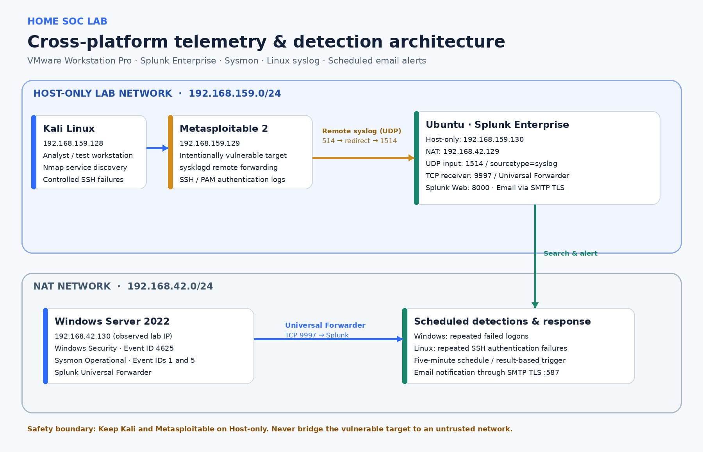
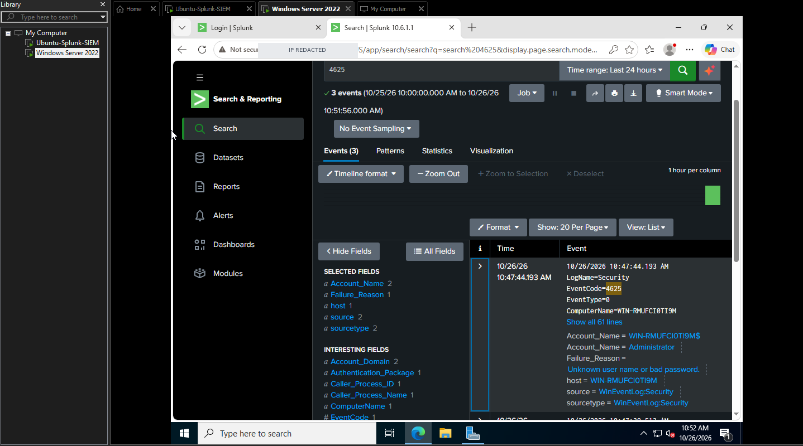
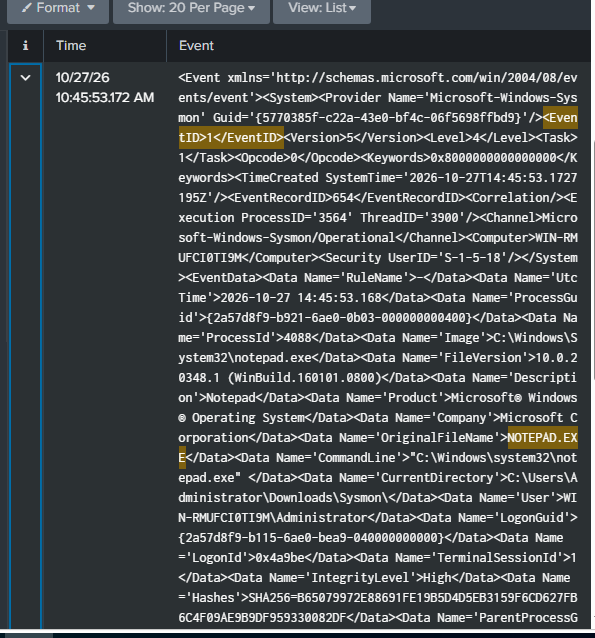
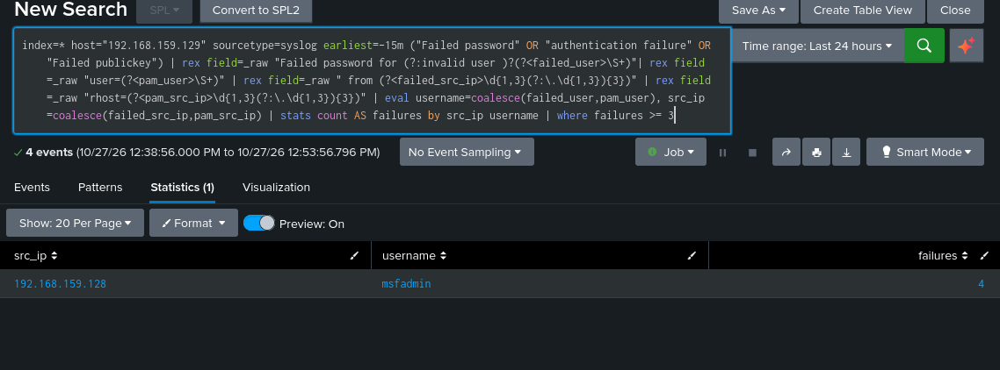

# SOC Lab Extension: Sysmon, Linux Syslog, and Authentication Detection

This folder documents the next phase of a VMware-based home SOC lab built around Splunk Enterprise. It extends the Windows Security monitoring baseline with Sysmon process telemetry and a deliberately vulnerable Linux target, while keeping attack simulations restricted to a Host-only virtual network.

## Highlights

- Centralized Windows Security and Sysmon events in Splunk Enterprise.
- Validated Sysmon Event ID 1 (process creation) and Event ID 5 (process termination) using a controlled Notepad launch.
- Forwarded Metasploitable 2 syslog messages to Splunk through an isolated lab network.
- Identified services on the lab target with Nmap service-version detection and manually viewed the target's HTTP and Tomcat pages.
- Generated controlled SSH authentication failures from Kali, searched the resulting SSH/PAM records in Splunk, and validated an email alert.
- Kept the intentionally vulnerable target on Host-only networking.

## Architecture

See [`docs/lab-architecture.md`](docs/lab-architecture.md) for the network paths, inputs, ports, and implementation details.

## Detection and query files

| File | Purpose |
|---|---|
| [`detections/windows-repeated-failed-logons.spl`](detections/windows-repeated-failed-logons.spl) | Windows Security Event ID 4625 count by host in a five-minute window |
| [`detections/metasploitable-ssh-failures.spl`](detections/metasploitable-ssh-failures.spl) | SSH/PAM failures grouped by source IP and username |
| [`queries/sysmon-process-creation.spl`](queries/sysmon-process-creation.spl) | Extract process image and command line from Sysmon Event ID 1 |
| [`detections/README.md`](detections/README.md) | Logic, scheduling, validation notes, and limitations |

## Evidence

Screenshots are organized in [`screenshots/windows/`](screenshots/windows/README.md) and [`screenshots/linux/`](screenshots/linux/README.md). The image files show observed lab outputs, not simulated/mock results.

## Selected evidence

Browse [`screenshots/README.md`](screenshots/README.md) for the complete screenshot index.

## Validation results

See [`docs/validation-results.md`](docs/validation-results.md). In summary, Windows Event ID 4625 and Sysmon events were searchable in Splunk; Metasploitable syslog and SSH/PAM authentication events were searchable; both the Windows and Linux repeated-failure alert workflows were observed to deliver email notifications after the Gmail app password and recipient-domain restriction were corrected.

## Safe-use scope

All scanning and login-failure tests were performed against the user's own intentionally vulnerable Metasploitable 2 VM on a private Host-only network. The documented phase includes service discovery and authentication-failure simulation; it does not claim that an exploit, credential-dumping tool, or malware payload was executed.
